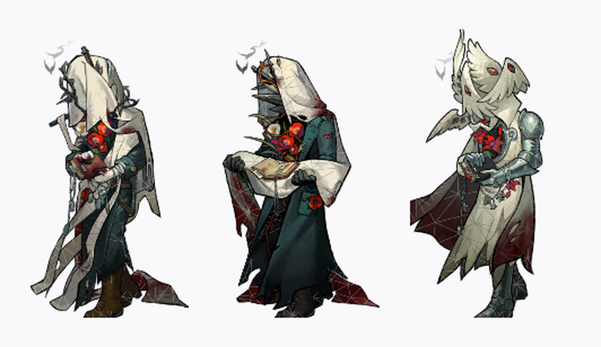

# CharonMascot · 卡戎桌宠

> Reverse: 1999 角色 **卡戎（Charon）** 的桌面宠物。透明置顶、Spine 骨骼实时渲染、点击互动、三套装扮。
> 用 C# + Avalonia 复刻 [NameDayMascot](https://github.com/HBrOcean/NameDayMascot) 的桌面宠物形态。

[](https://github.com/HBrOcean/CharonMascot/actions/workflows/build.yml)
[](https://github.com/HBrOcean/CharonMascot/releases)
[](LICENSE)
[](#-快速开始)
[](https://dotnet.microsoft.com/)



---

## ✨ 功能

- **实时 Spine 渲染**：直接加载官方 `.skel / .atlas` 骨骼数据，不是预渲染帧，放到 400% 也不糊。
- **三套装扮**：默认 / 沉默与悲鸣 / 亡者的恩赐，右键菜单或设置面板随时切换，无需重启。
- **一整套动作**：待机、登场、换装、定格、开心、受击、姿势、技能一/二/三、睡觉、专属、退场。
- **点击互动**：左键单击随机播放一个动作，播完自动回待机。
- **空闲表演**：闲置一段时间自己随机做动作（间隔可调，可关闭）。
- **拖拽 & 缩放**：左键拖动换位置；菜单或滑杆 50%–400%；`Ctrl + 滚轮` 快速微调。
- **透明置顶**：无边框、无背景、始终置顶、不占任务栏；可一键锁定位置防误拖。
- **全局热键**：`Ctrl+Alt+H` 显隐、`Ctrl+Alt+S` 设置、`Ctrl+Alt+Q` 退出。
- **一键截图**：右键「保存截图…」把当前帧存成 PNG。
- **配置持久化**：装扮、缩放、位置、开关项自动保存。

## 🖱 操作一览

| 操作 | 效果 |
| --- | --- |
| 左键拖动 | 移动窗口（未锁定时） |
| 左键单击 | 随机播放一个动作 |
| 右键单击 | 菜单：动作 / 装扮 / 缩放 / 置顶 / 锁定 / 截图 / 设置 / 退出 |
| `Ctrl` + 滚轮 | 缩放 ±10% |
| `Ctrl+Alt+H` | 显示 / 隐藏桌宠 |
| `Ctrl+Alt+S` | 打开设置面板 |
| `Ctrl+Alt+Q` | 退出程序 |

## 🚀 快速开始

### 直接用（推荐）

到 [Releases](https://github.com/HBrOcean/CharonMascot/releases) 下载对应平台的压缩包，解压后双击运行。
`Assets` 目录必须和可执行文件放在同一层。

> Windows 首次运行可能弹出「Windows 已保护你的电脑」，点「更多信息 → 仍要运行」即可
> —— 这是未签名程序的常规提示。

### 自己编译

需要 **.NET SDK 10.0 或更高**。

```bash
git clone https://github.com/HBrOcean/CharonMascot.git
cd CharonMascot/src/CharonMascot
dotnet run
```

发布单文件可执行程序：

```bash
# Windows
build.bat

# Linux / macOS
./build.sh linux-x64     # 或 osx-arm64
```

产物在 `dist/<rid>/`。

## 🧱 技术栈

| 组件 | 用途 |
| --- | --- |
| .NET 10 + Avalonia 11.3 | 跨平台窗口、透明无边框 UI |
| spine-csharp 4.2（源码内置） | 骨骼解析、动画状态机 |
| SkiaSharp 2.88 | 逐三角形仿射绘制骨骼网格 |
| SharpHook 6.2 | 全局键盘热键 |
| System.Text.Json | 配置读写 |

渲染这块踩过的坑（`DrawVertices` 会碎、UV 不能翻转、`ComputeWorldVertices` 的 count 语义…）
全部写在 [GUIDE.md](GUIDE.md)，想看细节可以直接翻。

## 📁 目录结构

```
CharonMascot/
├─ src/CharonMascot/
│  ├─ Program.cs / App.cs           # 入口
│  ├─ AppHost.cs                    # 中枢：配置、模型、窗口、热键
│  ├─ PetWindow.cs                  # 透明置顶窗口、右键菜单、拖拽/缩放/点击
│  ├─ PetControl.cs                 # SkiaSharp 绘制 Spine 骨架
│  ├─ SettingsWindow.cs             # 设置面板（纯代码 UI）
│  ├─ HotkeyService.cs              # 全局热键
│  ├─ Config.cs                     # 配置持久化
│  ├─ SpineRuntime/SkeletonModel.cs # 模型加载、包围盒、动画
│  ├─ Spine/                        # spine-csharp 4.2 官方源码
│  └─ Assets/characters/<id>/       # 角色素材（skel / atlas / png）
├─ tools/fetch_assets.py            # 从 UTTU 下载素材
├─ tools/make_icons.py              # 生成应用图标
├─ build.bat / build.sh             # 一键构建
├─ push.bat / push.sh               # 一键推送到 GitHub
└─ docs/screenshots/                # 预览图
```

## 🎭 换角色 / 做自己的桌宠

1. 在 `tools/fetch_assets.py` 里把 `GARMENTS` 改成目标角色的 garmentId；
2. `AppHost.Garments` 同步修改；
3. `tools/make_icons.py` 改一下头像地址，生成新图标；
4. `dotnet run` 看效果。

素材接口规律（Q 版 Spine / 立绘 / 头像的直链格式）见 [GUIDE.md](GUIDE.md) 第 1 节。

## ❓ 常见问题

<details>
<summary>启动后什么都没有？</summary>

- 检查 `Assets` 目录是否和 exe 在同一层（少了它会启动失败）。
- 程序可能被隐藏了，按 `Ctrl+Alt+H` 唤回。
- 看屏幕右下角，默认出现在那里。
</details>

<details>
<summary>角色一大片透明 / 颜色很脏？</summary>

旧版本（v1.0.0）有这个问题，v1.1.0 已修复 —— 见 [CHANGELOG](CHANGELOG.md)。
请确认用的是 Releases 里最新的包。
</details>

<details>
<summary>热键没反应？</summary>

全局热键依赖 SharpHook。极少数安全软件会拦截键盘钩子，把程序加入白名单即可；
菜单里的操作不受影响。
</details>

<details>
<summary>配置在哪？想恢复默认怎么办？</summary>

`%APPDATA%\CharonMascot\config.json`（Linux/macOS 在 `~/.config/CharonMascot/`）。
删掉这个文件就是恢复默认。设置面板里也有「配置目录」按钮直接打开。
</details>

## 🤝 贡献

欢迎 Issue 和 PR，动手前可以看一眼 [CONTRIBUTING.md](CONTRIBUTING.md)。

## 📄 许可

- **代码**：[MIT](LICENSE)
- **角色素材**（`Assets/characters/`）：版权归 Bluepoch（深蓝互动）所有，取自
  [UTTU Archive](https://uttu.merui.net/profiles/charon/)，仅作个人学习交流，**不可商用、不可二次分发**。
- **spine-csharp**（`Spine/`）：Copyright © Esoteric Software LLC，遵循 Spine Runtimes License。

如果你是权利方且希望移除相关内容，请开 Issue，会尽快处理。

## 🙏 致谢

- [NameDayMascot](https://github.com/HBrOcean/NameDayMascot) —— 架构与交互的参考原型
- [UTTU Archive](https://uttu.merui.net) —— 素材数据库
- [Esoteric Software](http://esotericsoftware.com/) —— Spine 运行时
- [Avalonia](https://avaloniaui.net/) / [SkiaSharp](https://github.com/mono/SkiaSharp) —— 跨平台 UI 与图形

---

<p align="center">如果这只卡戎陪到了你，点个 ⭐ 呗</p>
